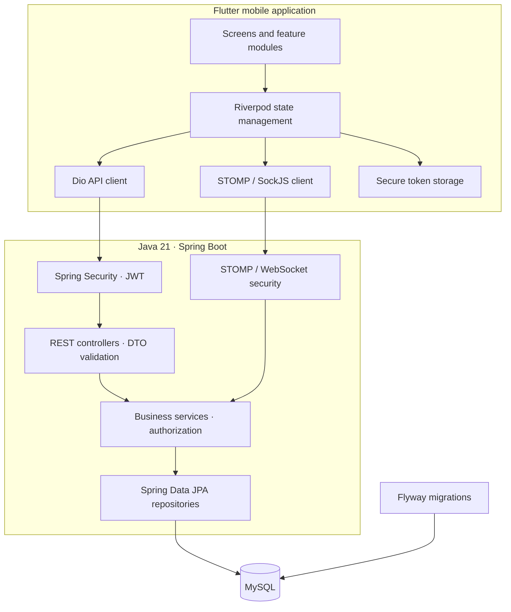

<div align="center">

# Mentorax

### Connecting students and alumni through a secure, community-driven networking platform.

A mobile-first alumni network for professional discovery, event participation, notifications, and real-time conversations — built with **Flutter, Java, Spring Boot, and MySQL**.

[](https://www.java.com/)
[](https://spring.io/projects/spring-boot)
[](https://flutter.dev/)
[](https://www.mysql.com/)
[](https://maven.apache.org/)

**[Repository](https://github.com/vinut-hna-coder-6057/Mentorax) · Built to explore reliable full-stack product engineering**

</div>

---

## The problem

Students often struggle to find relevant alumni, discover career events, and maintain meaningful professional connections after joining a college community. Alumni, in turn, need a practical way to share experience and engage with students. Administrators need visibility and control over membership and community activities.

**Mentorax brings these workflows into one mobile-first platform** with distinct student, alumni, and administrator experiences.

## Product overview


*Conceptual overview of the student, alumni, and administrator roles and how they interact.*

## Key capabilities

### 👥 Role-aware community

- Separate student, alumni, and administrator workflows.
- Student and alumni registration with email OTP verification.
- Alumni accounts remain pending until administrator approval.
- Professional profile management and discovery of approved community members.
- Connection requests to help members build a professional network.

### 💬 Real-time communication

- Direct messaging between connected users.
- STOMP over SockJS/WebSocket transport.
- JWT validation when establishing a STOMP connection.
- Protected messaging destinations and private user queues.
- Server-side checks for message operations and subscription access.

### 📅 Events and notifications

- Event creation and moderation workflows.
- Event registration and attendee tracking.
- Notifications for relevant community actions, including event and approval updates.
- Administrator workflows for reviewing alumni approvals and event activity.

### 🔐 Authentication and account safety

- JWT-based authentication for protected APIs.
- Email verification and password-reset flows kept separate.
- Short-lived, single-use OTP/reset workflows with attempt limits.
- Hashed OTP and reset-authorization values in persistence.
- Role-aware access checks and server-side ownership validation.
- Professional directory responses intentionally exclude sensitive account fields.

### 🧰 Backend and database engineering

- Layered Spring Boot application: controllers, services, repositories, and DTOs.
- Jakarta Bean Validation for request validation.
- Spring Data JPA/Hibernate for persistence.
- Flyway migrations with Hibernate schema validation.
- Environment-configured CORS and WebSocket origins.
- Bounded process-local rate limits for selected HTTP and STOMP operations.
- GitHub Actions workflows for backend, Flutter, and Android build checks.

> **AI mentor discovery:** Student-triggered alumni ranking is available through the authenticated Spring API. Its optional local TF-IDF service is separately deployable; the application remains usable with the transparent Java ranking fallback when that service is disabled or unavailable.

---

## Architecture



### Technology choices

| Layer | Technology | Responsibility |
|---|---|---|
| Mobile client | Flutter, Dart | Cross-platform mobile interface |
| State management | Riverpod | Manage client-side state and dependencies |
| Navigation | GoRouter | Route organization and navigation |
| HTTP | Dio | REST API communication |
| Real-time | STOMP over SockJS/WebSocket | Messaging and live updates |
| Backend | Java 21, Spring Boot | API endpoints and business workflows |
| Security | Spring Security, JWT | Authentication and authorization |
| Validation | Jakarta Bean Validation | Validate incoming request data |
| Persistence | Spring Data JPA, Hibernate | Data access and ORM |
| Database | MySQL | Persistent application data |
| Schema migrations | Flyway | Versioned database evolution |
| Build and checks | Maven, Flutter tooling, GitHub Actions | Repeatable builds and automated checks |

---

## Authentication and trust boundaries

Mentorax treats authentication and authorization as separate concerns.

1. A user registers and receives an email-verification OTP.
2. The verification flow validates the OTP and activates a student account after successful verification.
3. Alumni accounts require administrator approval after verification.
4. Login and protected operations enforce the applicable account state.
5. Password recovery uses its own OTP purpose and a short-lived reset authorization.
6. Protected service operations use the authenticated principal for identity and ownership checks rather than trusting a client-supplied user ID.

### Privacy-oriented decisions

- Public directory/detail responses expose professional profile information rather than private account fields.
- OTPs and reset authorization values are stored as hashes in the verification data model.
- Email verification and password reset are separate flows.
- CORS and WebSocket origins are configured through environment-specific settings.
- Secrets and service credentials should be supplied through environment configuration, never committed to source control.

---

## Repository layout

```text
Mentorax/
├── alumni-connect/                 # Spring Boot backend
│   └── src/main/
│       ├── java/                   # API, services, security, persistence
│       └── resources/
│           ├── db/migration/       # Flyway migrations
│           └── DATABASE_MIGRATION.md
├── alumni_connect_mobile/          # Flutter mobile application
│   ├── lib/
│   │   └── features/               # Feature-oriented screens and logic
│   ├── android/                    # Android application/build configuration
│   └── test/                       # Flutter tests
├── .github/workflows/              # Automated backend/mobile/build checks
└── README.md
```

*Exact filenames and folders may evolve as the project develops.*

---

## Getting started

### Prerequisites

Install the following tools before running the project:

- JDK 21
- Maven or the repository's Maven wrapper
- Flutter SDK and Dart
- Android Studio or Android SDK tooling for Android builds
- MySQL
- Git

### 1. Clone the repository

```bash
git clone https://github.com/vinut-hna-coder-6057/Mentorax.git
cd Mentorax
```

### 2. Configure the database and environment

Create a MySQL database for local development. Configure the backend's database connection and any required authentication, email, and application settings using the project's supported configuration mechanism.

**Do not commit real passwords, JWT signing secrets, SMTP credentials, or production connection strings.** Use local environment variables or an ignored local configuration file. Check the backend configuration and README files for the exact variable names expected by your checkout.

### 3. Run the backend

From the backend directory:

```bash
cd alumni-connect
```

On macOS/Linux:

```bash
./mvnw spring-boot:run
```

On Windows PowerShell:

```powershell
.\mvnw.cmd spring-boot:run
```

If the repository does not contain the Maven wrapper, use an installed Maven version:

```bash
mvn spring-boot:run
```

### 4. Run the Flutter app

Open a second terminal at the repository root:

```bash
cd alumni_connect_mobile
flutter pub get
flutter run
```

Choose an available emulator or connected device. Ensure the app's API base URL points to an address reachable from that device. For an Android emulator, `localhost` refers to the emulator itself, not automatically to your development computer.

### 5. Build an Android debug APK

```bash
cd alumni_connect_mobile
flutter build apk --debug
```

The APK is normally produced under:

```text
build/app/outputs/flutter-apk/app-debug.apk
```

For a release build, configure signing securely and follow the project's release instructions. Do not distribute a debug APK as a production release.

---

## Testing and quality checks

Run the checks relevant to the component you changed.

### Backend

```bash
cd alumni-connect
./mvnw test
```

Windows PowerShell:

```powershell
.\mvnw.cmd test
```

### Flutter

```bash
cd alumni_connect_mobile
flutter analyze
flutter test
```

### Android debug build

```bash
flutter build apk --debug
```

The project has included backend tests, Flutter analysis/tests, Android build checks, and CI workflows in development. Run them against your current checkout before relying on their result; a previous successful run is not a guarantee that every later change is safe.

## AI Mentor Discovery

Students can open **Find a mentor** from Home and submit a question to `POST /ai/career-assistant` (the older `/ai/mentor-discovery` path remains compatible). Spring Security requires a student JWT. A deterministic local intent classifier runs before discovery: career and explicit alumni questions may reach ranking; general questions, greetings, and unclear requests do not. The general-answer service is not configured, so factual questions receive an honest unavailable response rather than a guessed answer. No question is sent to an alumnus automatically.

For career searches, Spring derives the student from the security context and scans approved alumni in deterministic keyset batches of at most 500 profiles, using the `(role, status, id)` index and retaining a bounded page and top-10 result set in memory. Up to two ranking pages (at most 1,000 profiles) are sent in one bounded Python request while Python ranks each page independently; only professional profile fields (never alumni names or emails) are sent. `AI_MENTOR_MIN_RELEVANCE` configures normalized profile keyword overlap from 0 to 1. Semantic/hybrid retrieval also passes a configurable raw cosine gate (`AI_MENTOR_MIN_SEMANTIC_RELEVANCE`, default `0.72`) and requires substantive role, skill, interest, or bio fields. The cosine gate is uncalibrated, not a probability; the displayed estimate remains lexical overlap. Semantic cosine scores can be merged across pages; page-relative TF-IDF and hybrid scores cannot, so multi-page TF-IDF/hybrid requests use the global Java evidence order and are marked as fallback. A Flyway migration adds the keyset index to supported database histories. A separate held-out blind-review protocol is documented in `mentorax-ai/evaluation/heldout`; its 48-query review has not been completed or scored.

The default `AI_MENTOR_ENABLED=false` keeps the Python service optional. Java keyword overlap remains the fallback. To run the TF-IDF ranker locally, open PowerShell at the repository root:

```powershell
cd mentorax-ai
py -m venv .venv
.\.venv\Scripts\Activate.ps1
python -m pip install -r requirements.txt
uvicorn app:app --host 127.0.0.1 --port 8090
```

Configure Spring with `AI_MENTOR_ENABLED=true`, `AI_SERVICE_URL=http://127.0.0.1:8090`, and (optionally) `AI_MENTOR_MIN_RELEVANCE=0.0`. Restart Spring after changing environment values. In hosted environments, set the service URL to a private backend-reachable address and restrict ingress to Spring. Set `AI_MENTOR_ENABLED=false` to disable Python; qualified career searches use the fallback. The default ranker is TF-IDF and does not load a model. For semantic or hybrid ranking, set Python's `MENTOR_RANKING_STRATEGY` to the same strategy as Spring to start model warmup in the background at service launch; check `GET /ready?strategy=semantic` before routing semantic traffic. If warmup is still in progress, Python returns 503 promptly and Spring keeps its existing Java fallback. The optional strategies use the pinned local Sentence Transformers model described in `mentorax-ai/README.md`; no LLM or paid API is required.

Each result includes professional profile evidence, an uncertainty note, a suggested topic, and an editable message draft. A bio can provide positive evidence when role and skill fields are incomplete. An explicit alumni-question request shows the possible recipients and states that the question was not sent. **Copy draft** and **Request connection** remain separate student actions; after a connection is accepted, students can review and send a message using the existing chat. Ranking uses lexical profile evidence and optional semantic ordering; it does not infer mentor availability, response likelihood, or mentoring preference, which the current schema does not store. Semantic/hybrid quality and thresholds still need independent labeled validation. General factual answering remains unavailable until a dependable answering source is selected and deployed.

---

## Important engineering trade-offs

- **Real-time broker:** the current Spring simple broker is in-memory and suited to a single application instance. Horizontal scaling would require a shared messaging/broker strategy and coordinated session behavior.
- **Rate limiting:** the existing process-local limits do not automatically coordinate across multiple backend instances. Distributed deployment calls for a shared limiter.
- **Database evolution:** schema changes should be made through new Flyway migrations; already-applied historical migrations should not be rewritten casually.
- **Deployment:** production hosting, production-scale capacity, and end-to-end operational performance should be verified separately before being claimed as production-ready.

These constraints are documented intentionally: they make the architecture's current boundaries visible and provide a practical path for future hardening.

## Roadmap

Potential next steps, not claims of existing functionality:

- [ ] Shared rate limiting for multi-instance deployments
- [ ] External message broker for horizontally scaled real-time messaging
- [ ] Expanded integration and end-to-end test coverage
- [ ] Deployment runbooks, observability, and operational dashboards
- [ ] Structured mentorship matching and recommendations
- [ ] Accessibility and usability testing with real student/alumni users

## Contributing

Issues and pull requests are welcome.

1. Fork the repository.
2. Create a focused feature branch.
3. Make the smallest clear change that solves the problem.
4. Run the relevant backend/mobile checks.
5. Open a pull request with the motivation, implementation notes, and test results.

Please do not include credentials, real user data, or production secrets in issues, logs, screenshots, or commits.

## Author

**Vinuthna** — Computer Science (AI & ML) undergraduate interested in backend engineering, full-stack development, and reliable software systems.

- GitHub: [@vinut-hna-coder-6057](https://github.com/vinut-hna-coder-6057)
- Project: [Mentorax repository](https://github.com/vinut-hna-coder-6057/Mentorax)

---

<div align="center">

**Mentorax — bringing students and alumni closer through technology.**

If you find the project interesting, explore the code and share feedback.

</div>
